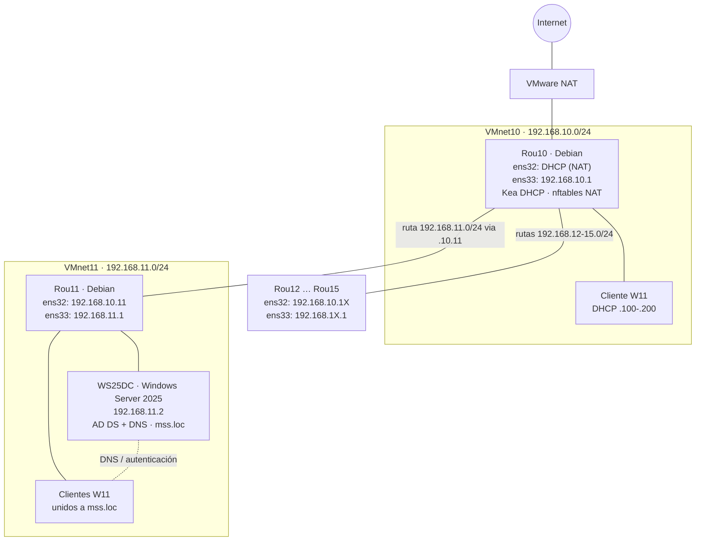

# Diagrama de red del lab

| Equipo | Red | IP | Función |
|---|---|---|---|
| Rou10 | NAT + VMnet10 | DHCP / 192.168.10.1 | Router de borde, DHCP, NAT |
| Rou11…Rou15 | VMnet10 + VMnet1X | 192.168.10.1X / 192.168.1X.1 | Router de cada subred |
| WS25DC | VMnet11 | 192.168.11.2 | Controlador de dominio y DNS de `mss.loc` |
| Clientes W11 | VMnet10 / VMnet11 | DHCP | Pruebas y equipos del dominio |
