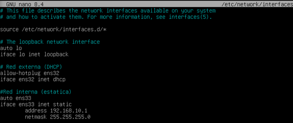
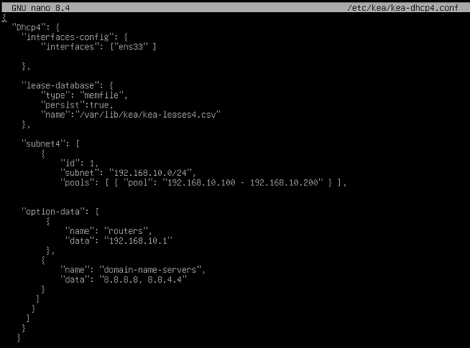
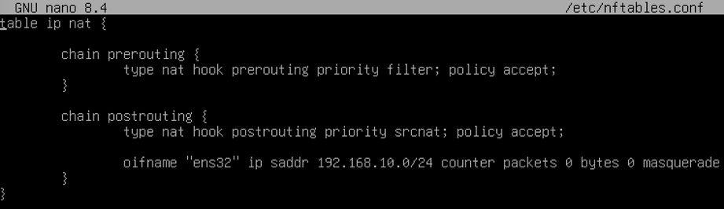
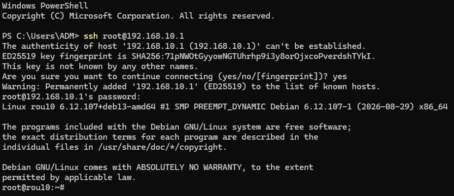
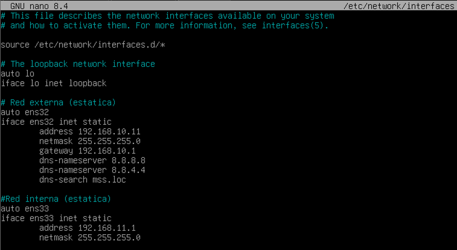
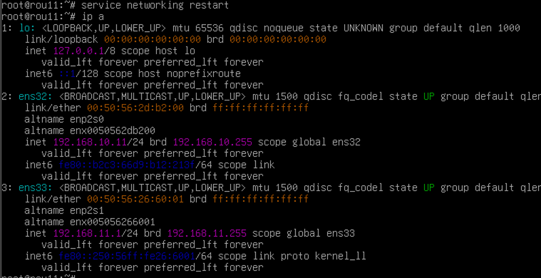
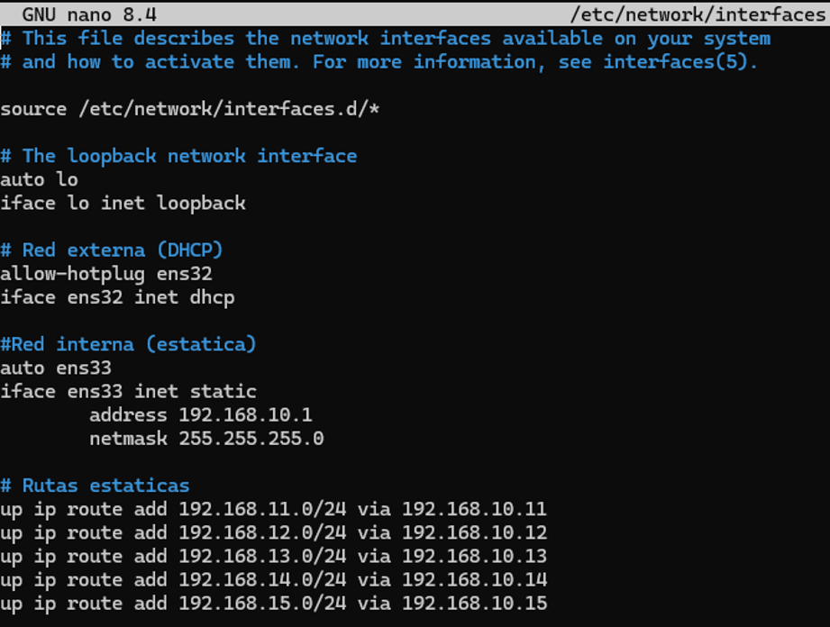

# 01 · Router Debian con DHCP Kea, NAT y rutas

Cada subred del lab tiene su router Debian. El primero, **Rou10**, es el de borde: sale a internet. Los demás (Rou11, Rou12…) son clones suyos.

Ficheros completos en [`../configs/`](../configs/).

## 1. Adaptadores de Rou10

Dos adaptadores de red en VMware:

| Interfaz | Red VMware | IP | MAC (convención) |
|---|---|---|---|
| `ens32` | NAT (internet) | DHCP | acaba en `:00` |
| `ens33` | VMnet10 | `192.168.10.1/24` fija | acaba en `:01` |

La convención de MAC permite saber de un vistazo qué adaptador va hacia fuera y cuál hacia dentro. Al clonar, **siempre se cambia la MAC**.

Nombre del equipo en `/etc/hostname` y `/etc/hosts`. Red en `/etc/network/interfaces`:

```
auto ens33
iface ens33 inet static
        address 192.168.10.1
        netmask 255.255.255.0
```

```bash
service networking restart
ip a
```



## 2. Repositorios y actualización

`/etc/apt/sources.list` apuntando a Debian 13 (trixie) y sin la línea del cdrom ([fichero](../configs/rou10/sources.list)).

```bash
apt-get update && apt-get upgrade
```

## 3. Servidor DHCP (Kea)

```bash
apt install -t trixie kea-dhcp4-server kea-common
nano /etc/kea/kea-dhcp4.conf
systemctl restart kea-dhcp4-server
```

Escucha en `ens33` y reparte `192.168.10.100-200`, con puerta de enlace `192.168.10.1` ([fichero](../configs/rou10/kea-dhcp4.conf)).



**Prueba:** un Windows 11 clonado y conectado a VMnet10 recibe IP del rango.

## 4. Enrutamiento y NAT

Reenvío de paquetes del kernel en `/etc/sysctl.d/99-ip_forward.conf`:

```
net.ipv4.ip_forward=1
```

```bash
sysctl --system          # aplica sin reiniciar
```

NAT por *masquerading* con nftables: la subred interna sale a internet por `ens32` ([fichero](../configs/rou10/nftables.conf)).

```bash
systemctl enable nftables.service
systemctl restart nftables
```



**Prueba:** el Windows 11 de la VMnet10 navega.

## 5. SSH desde la red interna

```bash
apt install ssh
# /etc/ssh/sshd_config
#   PermitRootLogin yes
#   PasswordAuthentication yes
#   ChallengeResponseAuthentication no
systemctl restart ssh
```



> ⚠️ Solo para el lab. En producción: usuario sin privilegios, `PermitRootLogin no` y autenticación por clave. Está en el [roadmap](../ROADMAP.md).

## 6. Clonar routers (Rou11, Rou12…)

1. Clon de Rou10 y MAC nuevas, con la misma convención (`:00` fuera, `:01` dentro).
2. Nombre nuevo en `/etc/hostname` y `/etc/hosts`.
3. `/etc/network/interfaces`: la pata externa pasa a ser **estática en la VMnet10** (`192.168.10.11`, gateway `192.168.10.1`) y la interna es `192.168.11.1` ([fichero](../configs/rou11/interfaces)).
4. En Kea y nftables, cambiar `192.168.10.x` por `192.168.11.x`. En nftables, además, se admite el tráfico entrante desde `192.168.10.0/24` por `ens33`.




## 7. Rutas entre subredes

Rou10 tiene que saber que detrás de cada clon hay una subred. Se añaden rutas estáticas en su `/etc/network/interfaces`:

```
up ip route add 192.168.11.0/24 via 192.168.10.11
up ip route add 192.168.12.0/24 via 192.168.10.12
...
```



**Prueba:** `ping` y `tracert` / `traceroute` entre equipos de distintas subredes. Llegan todos con todos.
