# 02 · Windows Server 2025 con Active Directory

Controlador de dominio **WS25DC** (`192.168.11.2`, en la subred de Rou11) para el dominio **`mss.loc`**.

## 1. Instalación

- Edición **Standard con Desktop Experience**: con interfaz gráfica. Datacenter solo aporta lo que en el lab no hace falta.
- En Server Manager → Manage, se quita que arranque al iniciar sesión.
- VMware Tools y actualizaciones.

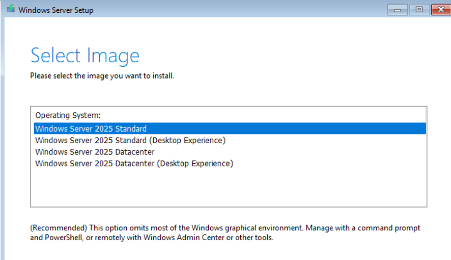

## 2. Antes de promover: IP fija y nombre

En un futuro controlador de dominio, la IP fija, el DNS apuntando a sí mismo y el nombre se dejan **antes** de promoverlo. Cambiarlos después obliga a limpiar los registros DNS a mano y deja el dominio inestable.

## 3. Rol AD DS y dominio `mss.loc`

Add Roles and Features → **Active Directory Domain Services** → promover a controlador de un bosque nuevo, `mss.loc`, con catálogo global y contraseña de **DSRM** (modo de restauración y despromoción).

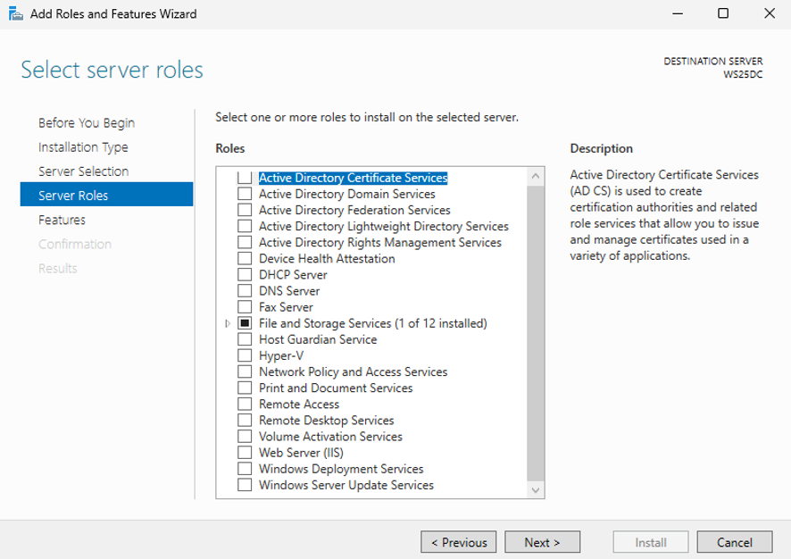
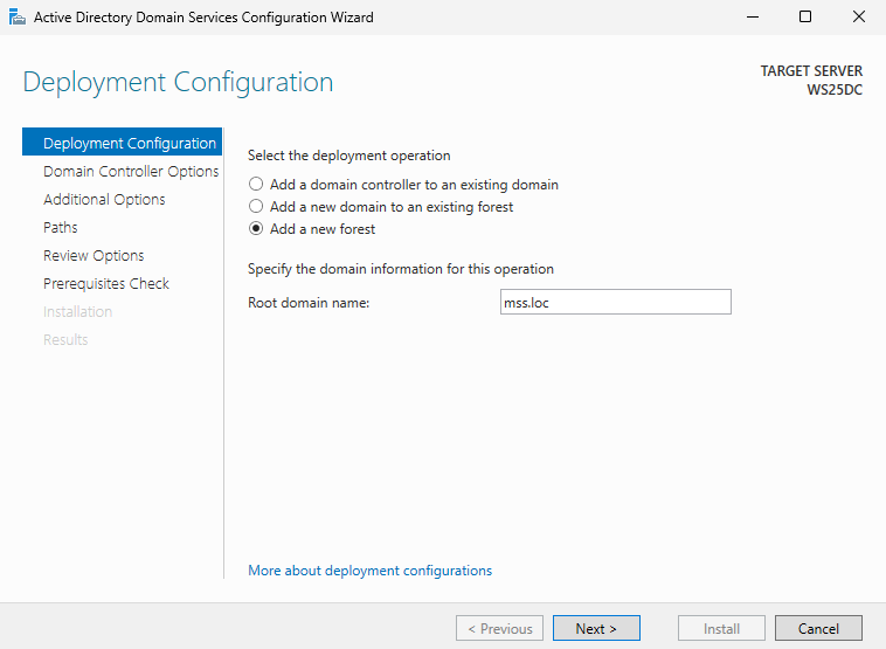

Criterio: nombres de usuario en minúscula, para no liarse luego con Linux.

## 4. Unir un cliente al dominio

El cliente debe usar como DNS **el del controlador de dominio** (`192.168.11.2`). Con el de Google no encuentra `mss.loc`. Tampoco se pone Google de DNS alternativo: así, si el DNS del DC falla, se nota enseguida.

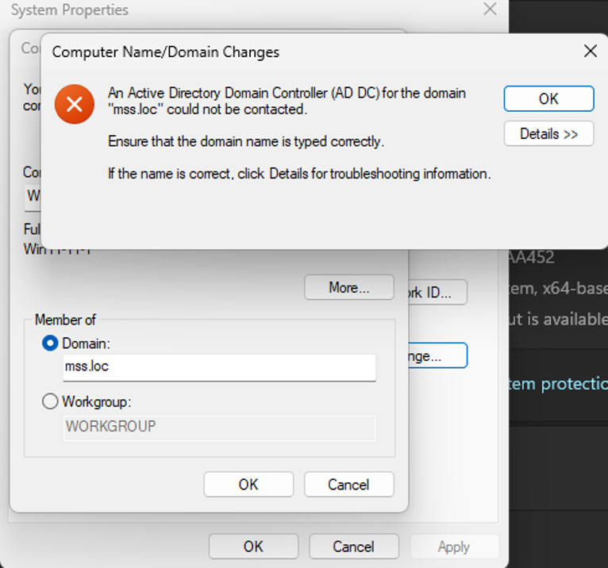
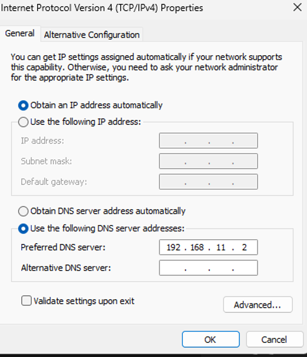
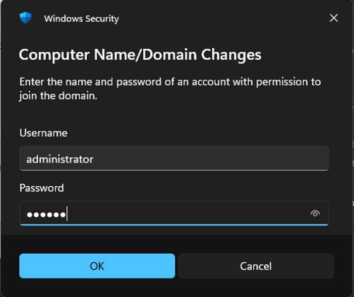

## 5. Contenedores y unidades organizativas

- `Builtin`, `Computers` y `Users` son **contenedores**, no OU: no se les puede vincular una GPO. Por eso se crean OU propias.
- `Domain Controllers` sí es una OU.
- El nombre único de un objeto es el `sAMAccountName`. El nombre visible se puede repetir.

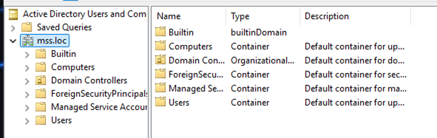
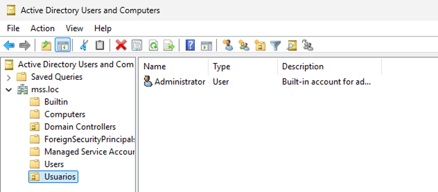

## 6. Usuarios, grupos y permisos por departamento

- 6 usuarios (`usu1`…`usu6`) y 3 grupos de departamento: depto1 = usu1 y usu2, depto2 = usu3 y usu4, depto3 = usu5 y usu6.
- Una carpeta por departamento. Se **desactiva la herencia** y se quita `Users`, de modo que solo entra su grupo.
- Dentro, una carpeta por usuario (solo su dueño) y una común del departamento.
- Una carpeta común para todos, con escritura, para pasarse ficheros entre departamentos.

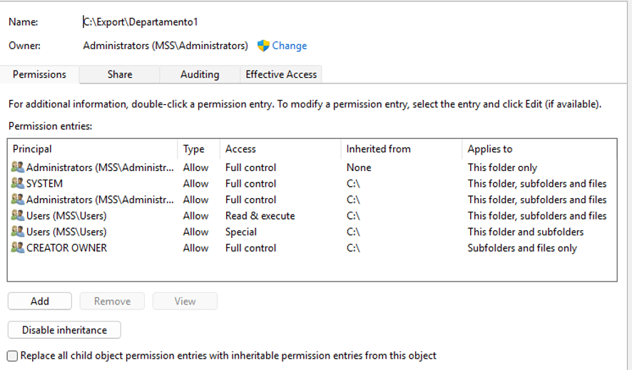
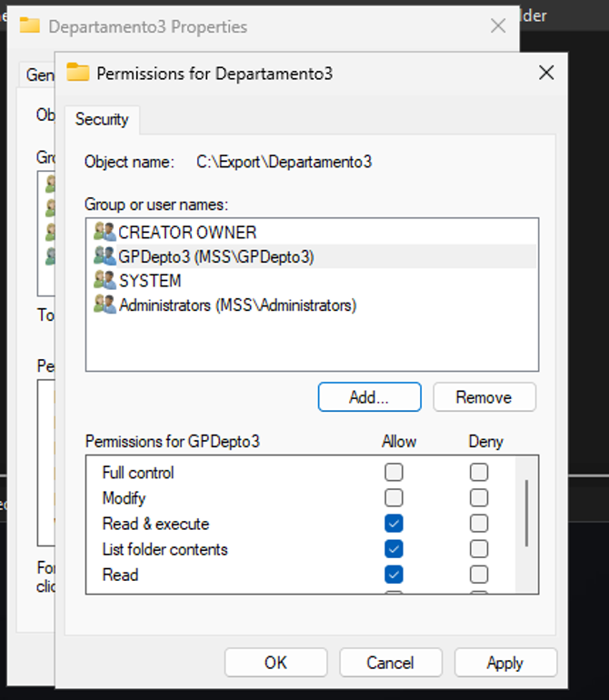
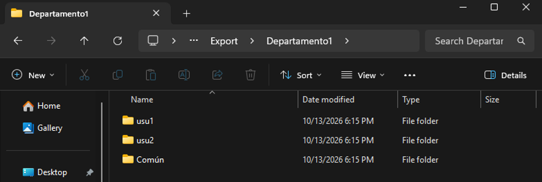

## 7. Directivas de grupo (GPO)

- Orden de aplicación **LSDOU**: local → sitio → dominio → OU. Gana la más cercana al objeto.
- Las GPO se crean en *Group Policy Objects* y se **vinculan** a OU.
- **SYSVOL** se replica a todos los DC: ahí no se toca nada a mano.
- Recurso compartido oculto `Dato$`. El `$` solo oculta, no protege.
- GPO de fondo de escritorio con ruta **UNC** (`\\WS25DC\Dato$\FONDOS\fondo.jpeg`), nunca local.
- `gpupdate /force` para aplicarla al momento.

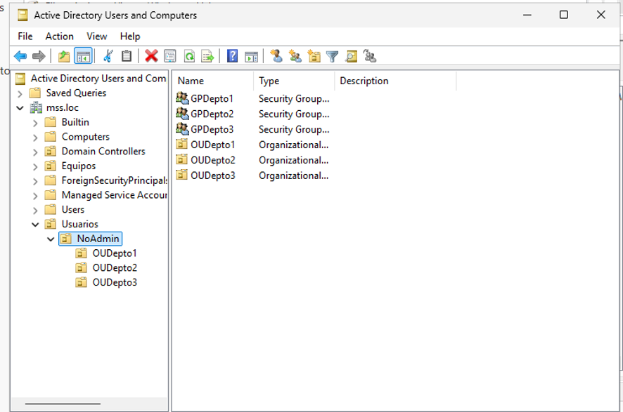
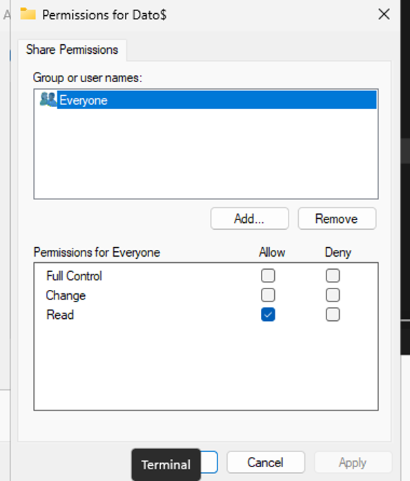
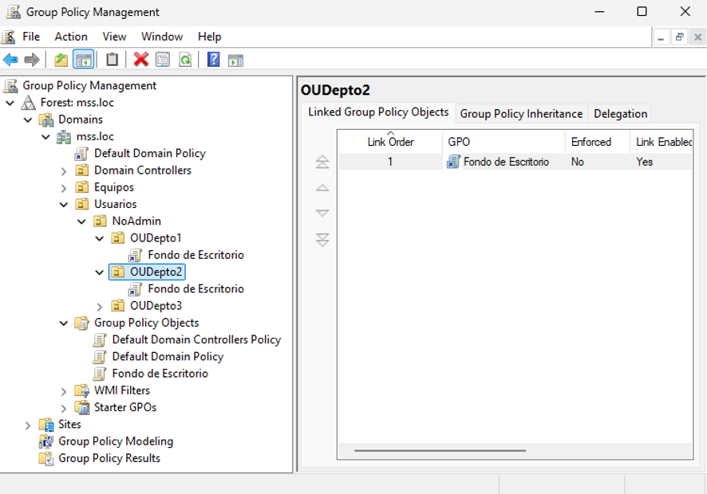

### Política de contraseñas

Lección aprendida: una política de contraseñas en una GPO vinculada a una OU **no afecta a las cuentas de dominio**, solo a las cuentas locales de los equipos de esa OU. Las de dominio las manda la **Default Domain Policy**, y es ahí donde se configuró.

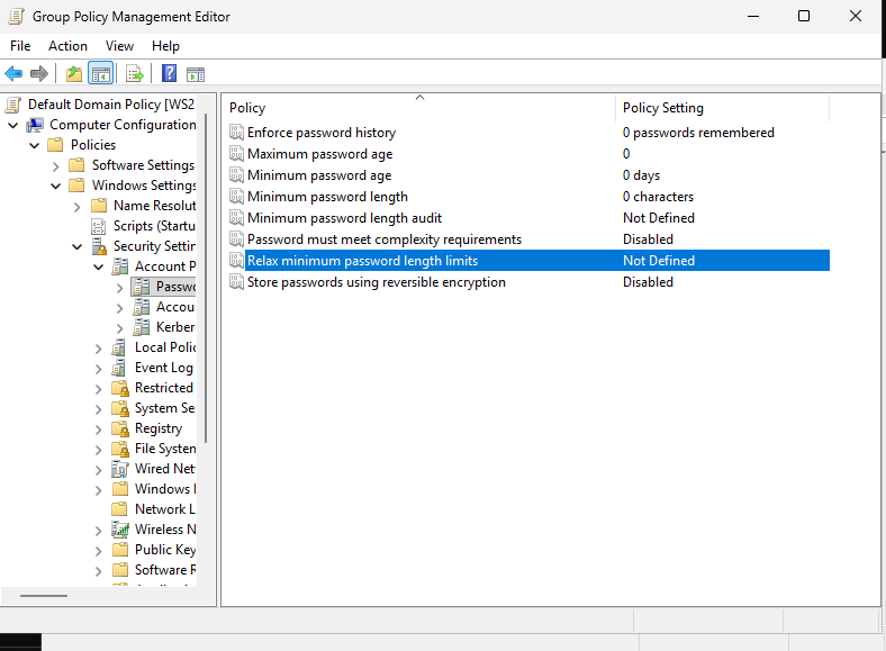

> ⚠️ En el lab se desactivó la complejidad para trabajar más rápido. En producción iría al revés: complejidad, longitud mínima e historial, o mejor, *Fine-Grained Password Policies*. Está en el [roadmap](../ROADMAP.md).
